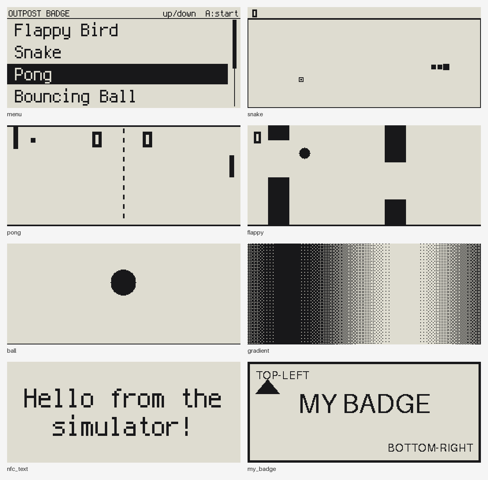

# Outpost badge firmware

**Status: work in progress. This is capability-testing firmware, not a product.**

The purpose of this code is to find out what the board can actually do and to
prove that a given board works: the RP2354A, the USB stack, the SSD1680 e-paper
panel, and the buttons. Everything here exists to answer a question or to
demonstrate a capability. Nothing here is a finished application.

Written in collaboration with Claude.

A note on the numbers here. Timings come from the board's own serial output, so
frame rates and refresh times are real measurements. Contrast is not: every
"good", "worse" or "too faint" in this folder is a judgement by eye, made from
A/B runs at matched frame rates. No optical instrument was used.

## What is proven

| Item | Status |
|---|---|
| RP2354A, USB, internal flash, CircuitPython | works |
| SSD1680 panel, full refresh | works, 2.29 s |
| SSD1680 partial refresh | works, 0.617 s stock |
| Fast partial refresh, 9.4 fps | works — see [epaper/README.md](epaper/README.md) |
| Animation demos (gradient, ball) | work |
| Playable game at ~9 fps | works |
| Buttons | works — all six, switch-to-ground (pull-up, active low) |
| NFC tag (ST25DV04K) over I2C | works — phone reads a URL; phone writes text and the badge displays it ([nfc/](nfc/)) |
| Menu launcher, hold A+B to return from any app | works — see [Menu and apps](#menu-and-apps) |
| Snake | works |
| Pong | works, ~8.8 fps |
| My Badge (own image + NFC contact card) | works |
| The LED behind the NFC chip | not tried |
| Behaviour at low temperature | not tried |
| Long-term panel safety of the short waveform | argued, not measured |

## Board facts

- **MCU:** RP2354A — an RP2350 with 2 MB of stacked internal flash. There is no
  external flash IC. It programs over the normal BOOTSEL USB bootloader.
- **Panel:** `0290BN800F6HP-DL`, 2.9 inch, 296x128, SSD1680 controller.
- **NFC:** ST25DV04K, 512 bytes of tag memory, on I2C1 (SDA GP10, SCL GP11,
  GPO GP12). It answers at three addresses: `0x53` (user memory and dynamic
  registers), `0x57` (system config), and `0x2D`. `0x2D` is the same chip, not
  a second device: ST's datasheet lists it, the netlist has nothing else on
  that bus, and a bit-banged scan sees it too. It ACKs, reads `0xFF` and
  refuses data writes; nothing here uses it. See `nfc/experiments/i2c_probe.py`
  and `i2c_bitbang.py`.
- **CircuitPython:** the stock `raspberry_pi_pico2` build works unchanged. The
  RP2 port reads the flash size from the chip's JEDEC ID, so CIRCUITPY sizes
  itself to the internal 2 MB.

### Pin map

| Signal | GPIO | Note |
|---|---|---|
| E-paper CS | GP13 | |
| E-paper SCK | GP14 | SPI1 SCK |
| E-paper MOSI | GP15 | SPI1 TX |
| E-paper BUSY | GP16 | high means busy |
| E-paper D/C | GP17 | |
| E-paper RST | GP18 | active low |
| Button up | GP7 | |
| Button left | GP8 | |
| Button right | GP6 | |
| Button down | GP9 | |
| Button A | GP5 | |
| Button B | GP4 | |
| NFC ST25DV04K | GP10, GP11 | I2C |
| NFC GPO | GP12 | |

The buttons are wired switch-to-ground: enable an internal pull-up and read a
press as a low level. Confirmed on hardware by playing `epaper/examples/flappy.py`.

The LED (D4) is driven by the NFC chip, not by a GPIO, so it cannot be used as a
"hello world" blink.

### Orientation

Landscape with the FPC cable to the **left**. The native row axis (296) runs
horizontally and the column axis (128) runs vertically. A vertical run on screen
is a contiguous bit run inside one panel row, which is the cheap drawing
primitive. See [epaper/README.md](epaper/README.md) for the full geometry notes.

## Layout

Work is split by subsystem. Each subsystem owns its own document, examples and
experiment trail. `lib/` and `tools/` are shared, because subsystems will
eventually be used together and a driver buried inside one of them is awkward to
import from the other. Only `epaper/` exists so far; NFC would be added as a
sibling.

```
firmware/
  lib/                 drivers and helpers; deployed to CIRCUITPY/lib/
    ssd1680.py         e-paper
    st25dv.py          NFC tag: I2C access, NDEF parse/build
    badge.py           buttons, the A+B exit combo, launching apps
    eink_text.py       wrapped, centred text (built-in font, any scale)
    gfx.py             screen-coordinate drawing for the fast-refresh games
  menu/
    menu.py            the launcher (becomes CIRCUITPY/code.py)
    apps.txt           which apps `deploy.sh --menu` installs
  tools/               shared
    deploy.sh          copy lib/ + one script, or the whole menu, to CIRCUITPY
    monitor.py         read the serial console
    preview.py         render app previews on your computer (no badge needed)
    font6x12.json      the badge's built-in font, for preview.py
  epaper/
    README.md          how the fast refresh works, and what it costs
    examples/          flappy, snake, pong, ball, gradient
    experiments/       the trail that produced the numbers
    tools/             recondition.py, compare.py  (panel-specific)
  nfc/
    examples/          nfc_text.py: show what a phone writes to the tag
    experiments/       bring-up scripts (I2C scan, probe, the 0x2D check)
  my_badge/            your own picture + NFC contact card
    img2badge.py       run on your computer
    my_badge.py        the menu app
```

### lib/

- `ssd1680.py` — raw SSD1680 driver: full refresh, stock partial refresh, and
  the fast partial path (custom LUT, charge pump held up, old-RAM sync).

### epaper/examples/

- `snake.py` and `pong.py` — D-pad games at the same ~9 fps tick as Flappy.
  Pong uses swept collision, because the ball moves further per frame than a
  paddle is wide.
- `gradient.py` — scrolling dithered gradient
  ([video](https://cdn.hackclub.com/019ff91d-8611-714b-98ba-4ad0f98be064/img_1216__yafw_balanced_.mp4)).
  This is the reference setting: 9.4 fps, confirmed good contrast. Use it to
  check a board end to end.
- `ball.py` — bouncing ball with free-fall physics
  ([video](https://cdn.hackclub.com/019ff91c-ea26-7483-82a6-17ceeb6396bf/img_1219__yafw_balanced_.mp4)).
  Solid black, which is a harder case for a short waveform than a dithered grey.
- `flappy.py` — Flappy Bird at ~8.9 fps
  ([video](https://cdn.hackclub.com/019ff91c-0464-7b39-83fa-bce072a783c1/img_1220__yafw_balanced_.mp4)).
  Buttons flap; set `AUTO_PILOT = True` for the computer player.

### tools/ (shared)

- `deploy.sh` — copy `lib/` and one script onto a mounted CIRCUITPY.
- `monitor.py` — read the board's serial console.

### epaper/tools/

- `recondition.py` — **ghost remover.** Run it when the panel shows residual
  images. It restores the factory waveform and drives 8 full black-white
  inversions. One white refresh does not clear deep ghosting.
- `compare.py` — A/B contrast harness. Runs two settings at the same frame rate
  with letter cards between them, so contrast can be judged by eye without the
  frame rate confusing the comparison.

## Quick start

The full menu with every app:

```bash
./firmware/tools/deploy.sh --menu
```

Or a single script, for development:

```bash
./firmware/tools/deploy.sh gradient
```

Then watch the console:

```bash
python3 firmware/tools/monitor.py /dev/cu.usbmodem101 20 passive
```

The argument to `deploy.sh` is a bare name or a path under `firmware/`:

```bash
./firmware/tools/deploy.sh flappy
./firmware/tools/deploy.sh epaper/examples/ball.py
./firmware/tools/deploy.sh recondition
```

`lib/*.py` goes to `CIRCUITPY/lib/`, and the chosen script becomes
`CIRCUITPY/code.py`. CircuitPython re-runs `code.py` on every save, so copying a
file restarts the program. Pass `passive` to `monitor.py` to avoid sending
Ctrl-C and Ctrl-D on top of that auto-restart.

## Previewing without a badge

`tools/preview.py` runs the real app scripts against a fake badge (a display that
records frames, scripted buttons, a virtual clock, a fake NFC tag) and writes a PNG
and GIF per app plus a contact sheet. It needs Pillow.

```bash
python3 firmware/tools/preview.py                  # everything -> ./preview/
python3 firmware/tools/preview.py --only snake pong
python3 firmware/tools/preview.py --image art.png  # My Badge with your own picture
```



It shows ideal pixels: ghosting, the contrast cost of the fast waveform and real
refresh timing are not modelled.

## Menu and apps

`deploy.sh --menu` installs `menu/menu.py` as `code.py` and every app listed in
`menu/apps.txt` into `CIRCUITPY/apps/`.

- **up / down** move the highlight, **A** or **right** starts the app.
- In any app, **hold A + B for one second** to return to the menu.

An app is just a script. The menu starts it with
`supervisor.set_next_code_file()` plus a reload, so it runs as if it were
`code.py`, and when it finishes it reloads and the menu runs again.

The exit is cooperative, not pre-emptive. `badge.Buttons.poll()` (or
`badge.ExitCombo.update()`) runs inside the driver's BUSY wait; after A+B has
been down for a second it raises `KeyboardInterrupt`. Every app already treats
that as "stop and tidy up", so its `finally` runs `power_off()` (rule 3 below)
and the panel is left clean. A script then ends with `badge.exit_to_menu()`,
which does nothing unless the menu is installed.

To write an app: create `badge.Buttons()`, pass `poll=buttons.poll` to
`frame_nopower()` (or call `buttons.poll()` in your loop), keep the
`try/except KeyboardInterrupt/finally power_off()` shape, and finish with
`badge.exit_to_menu()`. Limits: an app that hangs, or sits in a long loop that
never polls, cannot be left with A+B; use reset. A press during a 2.3 s full
refresh is seen when it ends.

Deploying a single script replaces `code.py` and removes `apps/`, so the board
is no longer a menu until you run `--menu` again.

## NFC

`lib/st25dv.py` reads and writes the tag's user memory over I2C. It writes only
user memory and dynamic registers; system config is read-only on purpose, since
a wrong write there can lock the tag from the RF side.

- `nfc/examples/nfc_text.py` polls the tag, and when a phone writes a Text, URL
  or vCard record, redraws the screen with it (one full refresh per change; a
  change must be seen twice in a row first, so a half-finished write costs
  nothing). The built-in font is ASCII only; anything else shows as `?`.
- The tag allows RF writes by default and nothing here changes that, so any
  phone can overwrite the badge's tag. That is what makes the demo work.
- `my_badge/` shows your own picture and publishes a URL or vCard. Make the data
  files on your computer with `my_badge/img2badge.py` (needs Pillow), then open
  *My Badge* in the menu. `badge.bin` and `badge_nfc.bin` live on CIRCUITPY, so
  redeploying never erases them. `nfc.url.json` and `nfc.vcard.json` hold
  personal details and are git-ignored. The converter and the NDEF builders
  are adapted from PR #2 by Tomas Kuchta; its RF write-protection toggling was
  left out because it would stop *NFC Text* working.

## Three rules that are not optional

The first two are explained with measurements in
[epaper/README.md](epaper/README.md). All three are also documented at the top of
`lib/ssd1680.py`, next to the code they apply to.

1. **Keep the old RAM in sync during partial refresh.** Use
   `frame_nopower(..., sync_old=True)`. Without it, charge accumulates in one
   direction and the panel stops responding after about 80 frames, with no sign
   of trouble in the timing data.
2. **Call `epd.init()` before any full refresh that follows `arm_partial()`.**
   `arm_partial()` leaves the custom waveform loaded, so a plain full refresh
   runs the short waveform and is almost invisible: 0.613 s instead of 2.29 s.
3. **Call `epd.power_off()` when you finish, from a `finally`.**
   `arm_partial()` leaves the charge pump up on purpose — that is where the
   free speed comes from — and only `power_off()` lowers it. A full refresh
   powers down inside its own sequence; the fast path does not.

   `except KeyboardInterrupt` is not enough. CircuitPython's auto-reload fires
   every time `deploy.sh` copies a file, and it does not raise
   `KeyboardInterrupt`; neither does an unexpected exception. Both skip an
   except-only handler and leave the supply energised.

   ```python
   try:
       epd.arm_partial(tpa=2, frame_rate=0x44, groups=None)
       while True:
           epd.frame_nopower(buf, sync_old=True)
   finally:
       epd.power_off()
   ```

## If the panel looks wrong

- **Ghosting or faint leftover images** — run `./firmware/tools/deploy.sh
  recondition`.
- **A weak or invisible full refresh** — a missing `epd.init()`; see rule 2.
- **Motion stops after a few seconds** — a missing old-RAM sync; see rule 1.
- **Everything mirrored** — `FLIP_X` / `FLIP_Y` in `epaper/examples/flappy.py`. Note
  that a coordinate flip and the viewing inversion cancel for a static shape, so
  text does **not** need extra mirroring on top of `FLIP_X`.
